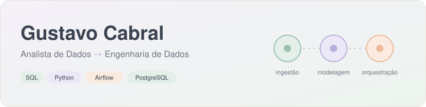
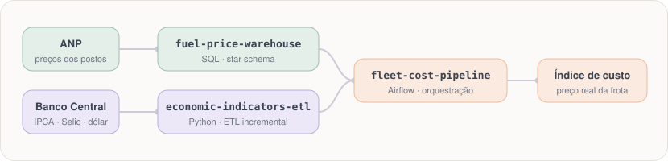
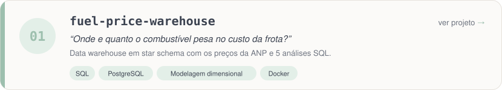
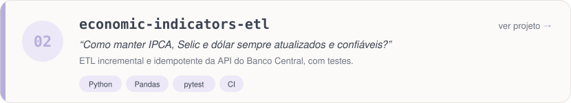
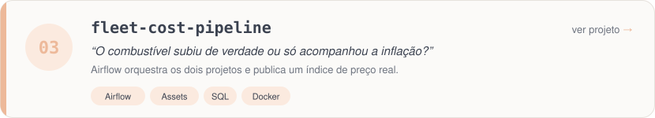
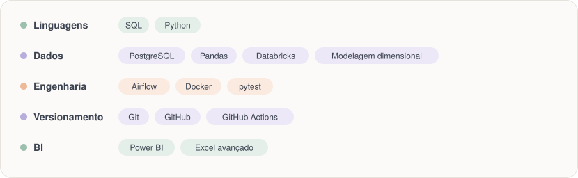

<picture>
  <source media="(prefers-color-scheme: dark)" srcset="assets/header-dark.svg">
  
</picture>

 

Construo consultas, modelos e dashboards para a **controladoria** de uma empresa de gestão de frotas. Agora estou dando o passo anterior na cadeia: **os pipelines que entregam o dado pronto, confiável e no horário.**

- 🎓 Bacharel em Ciência da Computação
- 🌱 Estudando agora: Apache Airflow, Docker e Databricks

## Projetos em destaque

Três projetos com dados públicos que contam uma história só: **quanto custa, de verdade, rodar uma frota no Brasil.**

<picture>
  <source media="(prefers-color-scheme: dark)" srcset="assets/mapa-dark.svg">
  
</picture>

<a href="https://github.com/GustavoCabral22/fuel-price-warehouse">
  <picture>
    <source media="(prefers-color-scheme: dark)" srcset="assets/projeto-1-dark.svg">
    
  </picture>
</a>

<a href="https://github.com/GustavoCabral22/economic-indicators-etl">
  <picture>
    <source media="(prefers-color-scheme: dark)" srcset="assets/projeto-2-dark.svg">
    
  </picture>
</a>

<a href="https://github.com/GustavoCabral22/fleet-cost-pipeline">
  <picture>
    <source media="(prefers-color-scheme: dark)" srcset="assets/projeto-3-dark.svg">
    
  </picture>
</a>

## Ferramentas

<picture>
  <source media="(prefers-color-scheme: dark)" srcset="assets/stack-dark.svg">
  
</picture>

## Vamos conversar

💼 [LinkedIn](https://www.linkedin.com/in/gustavoscabral) &nbsp;·&nbsp; ✉️ [gustavo.s.cabral98@gmail.com](mailto:gustavo.s.cabral98@gmail.com) &nbsp;·&nbsp; 📍 Porto Alegre, RS
